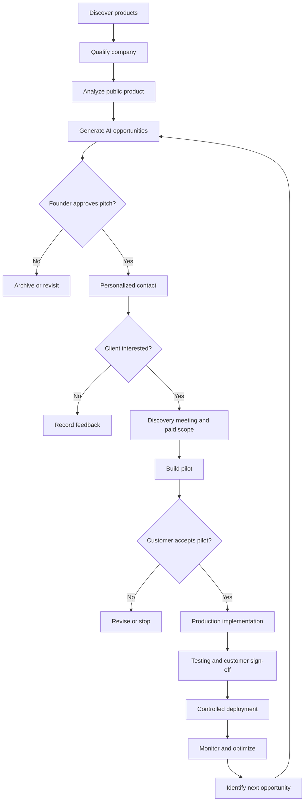

# Standard Eight-Stage Workflow

> **Status:** Working operating model · **Source:** Playbook v1.0 §8.2, §9.4 · **Updated:** 2026-11-09
>
> **Related:** [Key activities](key-activities.md) · [Sales pipeline](../02-go-to-market/sales-pipeline.md) · [Delivery quality checklist](delivery-quality-checklist.md) · [Discovery data rules](../discovery/README.md)

| Stage | Engine | Where the output lives |
|---|---|---|
| 1. Company discovery | Opportunity | `discovery/companies/<id>/company.md` |
| 2. Product analysis | Opportunity | `discovery/companies/<id>/product-analysis.md` |
| 3. Opportunity generation and ranking | Opportunity | `discovery/companies/<id>/opportunities.md` |
| 4. Personalized pitch and initial contact | Opportunity | `discovery/companies/<id>/outreach.md` |
| 5. Discovery, feasibility, commercial agreement | Delivery | [Discovery Report](../templates/discovery-report.md) (client workspace) |
| 6. Pilot implementation and evaluation | Delivery | [Pilot Acceptance Report](../templates/pilot-acceptance-report.md) |
| 7. Production integration and release | Delivery | Client delivery workspace |
| 8. Monitoring, support, and expansion | Delivery | [Monthly Operations Report](../templates/monthly-operations-report.md) |

---

## Stage 1 — Company discovery

**Purpose:** Build a qualified pipeline of software products in Iran.

- **Inputs:** Public company/app listings, product websites, sector research, referrals.
- **Actions:** Identify company and product, classify segment, capture official URLs and contact sources, estimate ICP fit, deduplicate records.
- **Deliverable:** Company record with initial qualification score and evidence.
- **Gate:** Human review before allocating meaningful custom research effort.

## Stage 2 — Product analysis

**Purpose:** Understand the product before proposing a solution.

- **Actions:** Map visible user journeys and known features; identify repetitive tasks; infer potential friction; identify exposed, legitimate integration surfaces; mark everything unknown that requires client confirmation.
- **Deliverable:** Evidence-backed product analysis with assumptions and confidence levels.
- **Gate:** No unauthorized access, scraping of protected data, or claims to have inspected non-public features.

## Stage 3 — Opportunity generation and ranking

**Purpose:** Generate high-value, plausible AI agents.

- **Actions:** Produce approximately three candidate ideas per promising company, each with business hypothesis, use case, workflow change, required data, integrations, risks, cost considerations, and KPIs. Score them and select one or two for outreach.
- **Deliverable:** Ranked AI opportunity portfolio.
- **Gate:** Founder approves selected ideas and rejects implausible or risky concepts.

## Stage 4 — Personalized pitch and initial contact

**Purpose:** Open an informed commercial conversation.

- **Actions:** Prepare short proposal and outreach message; verify publicly available facts; identify and respectfully contact an appropriate decision-maker; track response.
- **Deliverable:** Approved outbound proposal, meeting request, updated CRM.
- **Gate:** Human review before sending; no spam-like bulk automation.

## Stage 5 — Discovery, feasibility, and commercial agreement

**Purpose:** Convert an idea into a technically and commercially grounded project.

- **Actions:** Founder-led discussion, process mapping, permissions/data inventory, API assessment, success metrics, budget and schedule discovery, risk review, and paid scope proposal.
- **Deliverable:** Signed discovery/pilot scope with owners and acceptance criteria.
- **Gate:** Customer authorizes relevant access and approves project terms.

## Stage 6 — Pilot implementation and evaluation

**Purpose:** Test whether the idea actually works and creates value.

- **Actions:** Build limited agent, integrate with permitted sandbox/test systems, create evaluation set, assess task success, hallucination/failure modes, permissions, performance, and cost.
- **Deliverable:** Working pilot, demonstration, evaluation report, production/no-go recommendation.
- **Gate:** Customer acceptance and a separately agreed production scope.

## Stage 7 — Production integration and release

**Purpose:** Put a reliable feature into the existing product.

- **Actions:** Production-grade architecture, API and UI integration, auth/authorization, tool permissions, logs, error handling, monitoring, security review, automated tests, staging acceptance, rollback plan, gradual rollout, documentation.
- **Deliverable:** Accepted production agent and operational handover.
- **Gate:** Explicit customer acceptance and deployment approval; no autonomous deployment to client production without authorization.

## Stage 8 — Monitoring, support, and expansion

**Purpose:** Sustain quality and discover subsequent value.

- **Actions:** Monitor reliability, latency, task-success rates, cost, user feedback, incidents, and business KPIs; fix problems; improve evaluations; offer new opportunities based on evidence.
- **Deliverable:** Performance reports, agreed maintenance releases, renewal/expansion proposals.
- **Gate:** Changes to contract scope, high-impact tool permissions, or production behavior require approval.

---

## High-level prospective internal workflow

