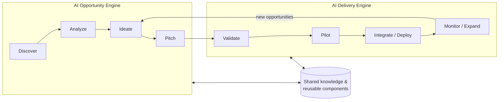

# Key Activities — Canvas Block 6

> **Status:** Working operating model · **Source:** Playbook v1.0 §8.1, §8.3 · **Updated:** 2026-11-09
>
> **Related:** [Eight-stage workflow](eight-stage-workflow.md) · [Internal agent roles](internal-agent-roles.md) · [Reuse & productization](reuse-and-productization.md)

## 1. Two-engine operating model

**AI Opportunity Engine** — Find companies, analyze products, identify agent ideas, validate and prioritize opportunities, personalize outreach, and convert leads. *(Its working data lives in [`docs/discovery/`](../discovery/README.md).)*

**AI Delivery Engine** — Agree scope, build pilots, integrate agents, evaluate quality, deploy safely, monitor, support, and expand.

Both engines feed a **shared knowledge and reusable-component layer**: industry use cases, customer objections, agent templates, connectors, integration patterns, evaluation test sets, pricing data, and reusable code.

## 2. Agent and human responsibility matrix

| Stage | Agent assistance | Human responsibility |
|---|---|---|
| Discover | Search/classify public businesses | Choose target markets, approve high-value leads |
| Analyze | Summarize product structure and opportunities | Verify the actual evidence |
| Ideate | Generate concepts and alternatives | Select feasible, relevant concepts |
| Pitch | Draft proposal/deck/message | Approve facts and send outreach |
| Discovery | Prepare questions and notes | Speak with client and agree requirements |
| Implementation | Draft code, tests, documentation | Review architecture, code, and security |
| Quality | Run test/eval workflows and flag anomalies | Sign off acceptance and risk |
| Deployment | Prepare release notes and checklist | Approve and carry out authorized release |
| Support | Analyze logs, recommend fixes, surface incidents | Own communication and production actions |
