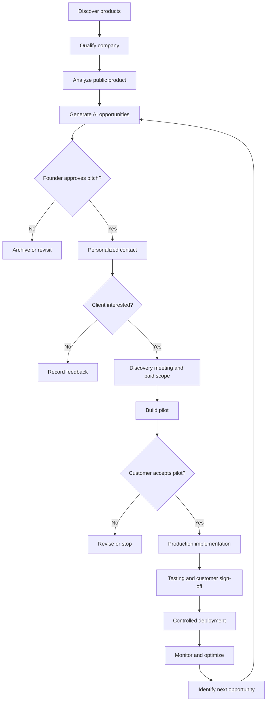

# ENSA AI — Business Model Canvas & Operating Playbook

**Version:** 1.0 (working strategy)  
**Date:** 9 November 2026  
**Initial target market:** Iran  
**Business concept:** AI Innovation + Implementation  
**Commercial positioning:** Balanced specialist  
**Sales model:** Founder-led sales, supported by AI-assisted research  
**Scope:** Comprehensive consolidation of the ENSA AI strategy discussion through Business Model Canvas Block 6

> **Document status.** This is a strategy and execution working document, not a validated market study or a final legal/financial plan. Items tagged **DECIDED** reflect explicit choices made in our discussion. Items tagged **PROPOSED**, **HYPOTHESIS**, or **TO VALIDATE** are recommendations or assumptions that must be tested. Currency amounts refer to **millions of Iranian toman**, unless noted otherwise. All prices exclude applicable taxes and third-party usage costs unless a signed quotation says otherwise.

---

## 1. Executive summary

**ENSA AI** is an AI product innovation and engineering company for existing software businesses. Instead of waiting for clients to ask for a chatbot or AI functionality, ENSA proactively finds websites, SaaS platforms, mobile applications, and business software products; studies how they work; discovers useful AI-agent opportunities; contacts the product owner with a tailored proposal; and, where the client agrees, designs, implements, deploys, and supports the AI agent within the existing product.

ENSA's core proposition is:

> **Turn existing software into smarter, more valuable products with AI agents.**

Persian positioning:

> ما به شرکت‌های نرم‌افزاری کمک می‌کنیم فرصت‌های جدید هوش مصنوعی را در محصولات خود کشف کنند، ایجنت‌های کاربردی بسازند و آن‌ها را مستقیماً به نرم‌افزارشان اضافه کنند.

The business differentiates itself by combining **proactive discovery**, **product-specific innovation**, **business-value measurement**, and **end-to-end AI engineering**. It is not intended to be merely an LLM reseller, a generic chatbot vendor, or a conventional agency selling developer hours.

### The six explicit decisions so far

1. **DECIDED — Business model:** **Option B: AI Innovation + Implementation**, rather than idea-only consulting or a pure self-serve agent marketplace.
2. **DECIDED — Targeting:** Test **multiple software categories initially** instead of committing prematurely to one vertical. Evaluate which segment converts best.
3. **DECIDED — Customer acquisition:** **Founder-led, highly personalized sales**, with AI assisting research and proposal preparation. Do not launch with unreviewed bulk automated outreach.
4. **DECIDED — Customer relationship:** A collaborative, trust-based engagement designed to evolve from discovery and implementation to an ongoing AI innovation partnership.
5. **DECIDED — Monetization:** **Hybrid model:** paid discovery and implementation plus optional recurring support and optimization.
6. **DECIDED — Pricing position:** **Balanced specialist**: serious engineering capability for established software companies, with paid pilots, production delivery, and optional monthly services.

**Not yet decided:** organizational staffing model (lean core team vs. in-house team vs. partner-led network), Key Resources, Key Partners, and Cost Structure (Canvas Blocks 7–9). A lean core team plus specialists was recommended, but **has not been selected by the founder**.

---

## 2. Business Model Canvas — consolidated snapshot

| Block | Current definition | Status |
|---|---|---|
| **1. Customer Segments** | Existing Iranian software businesses, initially testing B2B SaaS, e-commerce/marketplaces, vertical SaaS, and consumer web/mobile apps | **DECIDED**: multi-segment test; ICP is proposed |
| **2. Value Propositions** | Discover, validate, implement, and optimize AI agents that create new revenue opportunities, reduce operating costs, or improve user experience | **DECIDED** direction; benefits must be validated |
| **3. Channels** | Personalized founder-led outbound, warm referrals, AI-opportunity content, and technology partners | **DECIDED**: founder-led core channel; mix is proposed |
| **4. Customer Relationships** | Personalized, consultative discovery; collaborative implementation; clear approvals; optional ongoing support and innovation | Working definition |
| **5. Revenue Streams** | Free lead preview; paid discovery; paid pilot; production integration; recurring managed support; metered AI/infrastructure usage | **DECIDED** hybrid model and balanced-specialist positioning; amounts are hypotheses |
| **6. Key Activities** | Discover → Analyze → Ideate → Pitch → Validate → Pilot → Integrate/Deploy → Monitor/Expand | Working operating model |
| **7. Key Resources** | Team, engineering capability, delivery toolkit, prospect/opportunity database, evaluation infrastructure, client trust | **TO DECIDE** |
| **8. Key Partners** | Model providers, hosting/infrastructure, software integrators, specialized contractors, distribution/referral partners | **TO DECIDE** |
| **9. Cost Structure** | Technical compensation, subcontractors, sales, infrastructure, tools, operations, QA/security, contingency | **TO DECIDE**; example financial scenario included below |

**Guiding principle:** Target multiple industries, but sell one repeatable service: *identify a valuable product-specific AI opportunity and implement it responsibly*.

---

# PART I — MARKET, CUSTOMER, AND OFFER

## 3. Canvas Block 1 — Customer Segments

### 3.1 Target market

**Geography:** Iran, with Persian-first communication, workflows, and product analysis. The business should account for local infrastructure, payment patterns, access constraints, regulatory requirements, and the availability of Persian-language data and AI services.

**Type of buyer:** An established company that already operates a website, SaaS application, mobile app, or business software product with real users and a plausible incentive to add AI capabilities.

**Not the initial focus:** Pre-product startups without users, generic one-off chatbot buyers, organizations with no budget or decision-maker access, and customers unwilling to provide the necessary authority or integration support.

### 3.2 Four initial target segments

The launch is a **controlled four-segment experiment**, not a broad, unfocused campaign.

| Segment | Example software categories | Illustrative AI agents | Why the segment may buy | Initial treatment |
|---|---|---|---|---|
| **A. B2B SaaS / business software** | CRM, HR, ERP, accounting, scheduling, project management | Sales follow-up, document processing, intelligent reporting, workflow executor | Recurring tasks and measurable operational value | Equal initial research effort |
| **B. E-commerce and marketplaces** | Online stores, marketplaces, booking services, seller platforms | Product discovery, customer support, order/return handling, catalog enrichment | Conversion, support efficiency, seller productivity | Equal initial research effort |
| **C. Vertical SaaS / industry-specific platforms** | Education, real estate, logistics, healthcare administration, sector-specific operations | Domain-specific assistants, document analysis, workflow coordination | Strong domain differentiation and repeatable industry workflows | Equal initial research effort |
| **D. Consumer web/mobile apps** | Productivity, learning, travel, lifestyle, personal services | Personalized assistants, recommendations, in-app task execution | Engagement, retention, premium features | Equal initial research effort |

**HYPOTHESIS:** B2B SaaS may be a good long-term beachhead because of recurring workflows and measurable outcomes, but the explicit choice is **not** to privilege it before testing. Segment prioritization should be driven by evidence from outreach, paid discovery, conversion, technical feasibility, and unit economics.

### 3.3 Ideal Customer Profile (ICP), version 1

| Dimension | Proposed profile |
|---|---|
| Location | Iran |
| Business maturity | Established product, active customers/users |
| Approximate size | **5–150 employees**, a heuristic rather than a firm limit; an earlier draft suggested 10–100 |
| Product | Live website, SaaS product, mobile app, or specialized business system |
| Decision-maker | Founder, CEO, CTO, Head/Director of Product |
| Technical readiness | API access or other legitimate integration mechanisms; structured workflows and sufficient data |
| Commercial readiness | Budget, a sponsor with approval authority, and interest in product differentiation, efficiency, or revenue |
| Opportunity signal | Clear workflow friction, manual processing, user-experience gap, or monetizable feature potential |
| Desired engagement | Paid discovery, pilot, production feature, and optionally support |

**Disqualifiers / flags:** No real user problem, inability to access required data legitimately, no buyer sponsorship, highly uncertain integration cost, uncompensated discovery demands, or requests requiring unsafe/unauthorized use of data.

### 3.4 Prospect qualification score (100 points)

Score each dimension from **0 to 5** and calculate `weighted points = weight × rating / 5`.

| Criterion | Weight |
|---|---:|
| AI opportunity value | 25 |
| Technical feasibility | 20 |
| Access to a decision-maker | 20 |
| Ability to pay | 15 |
| Repeatability of solution | 10 |
| Measurable business impact | 10 |
| **Total** | **100** |

**Proposed qualification bands:**

- **80–100:** High-priority account for personalized research and outreach.
- **60–79:** Investigate missing information before investing more effort.
- **Below 60:** Deprioritize until the fit changes.

These are operational hypotheses, **not statistically validated thresholds**. A high score must never override a legal, consent, privacy, or security blocker.

### 3.5 Segmentation validation experiment

**PROPOSED six-week target:** Research **80 companies**, split evenly across four categories (**20 each**). Send **40 highly personalized, human-approved pitches**, split **10 each**. Measure which segment yields qualified meetings, meaningful buying interest, paid discovery, acceptable delivery economics, and reusable technical assets.

Do **not** decide the winning segment by open or reply rates alone. Two serious, paying clients can be more valuable than a large number of polite replies. Six weeks yields directional evidence, not a definitive statistical verdict.

---

## 4. Canvas Block 2 — Value Proposition

### 4.1 Core English positioning

> **We discover, build, and integrate intelligent AI agents that make existing software products more valuable.**

Alternative concise headline:

> **Turn existing software into smarter, more valuable products with AI agents.**

### 4.2 Core Persian positioning

> ما فرصت‌های هوشمندسازی محصولات نرم‌افزاری را کشف می‌کنیم و با طراحی و پیاده‌سازی ایجنت‌های هوش مصنوعی، قابلیت‌های ارزشمند جدیدی به آن‌ها اضافه می‌کنیم.

Alternative:

> ما به شرکت‌های نرم‌افزاری کمک می‌کنیم فرصت‌های جدید هوش مصنوعی را در محصولات خود کشف کنند، ایجنت‌های کاربردی بسازند و آن‌ها را مستقیماً به نرم‌افزارشان اضافه کنند.

### 4.3 The three business outcomes

1. **Increase revenue:** Launch paid AI capabilities, encourage upsell, improve conversion, and differentiate products.
2. **Reduce operating cost:** Automate repetitive or manual operations, reduce processing time, improve consistency, and support teams at greater scale.
3. **Improve user experience:** Make existing workflows faster, more personalized, more helpful, and easier to complete.

Every proposal should name its **primary outcome** and the metrics that will verify it. Do not promise improvements or ROI before collecting customer baseline data.

### 4.4 Why buy from ENSA rather than build internally?

Established software companies may already have engineers who can call an LLM API. ENSA must provide more than basic API integration:

- **Proactive, product-specific discovery:** Identify high-value opportunities the existing roadmap may not have prioritized.
- **Business-first evaluation:** Tie agent features to a customer problem and measurable benefit.
- **End-to-end implementation:** Handle architecture, evaluation, integrations, testing, controlled release, documentation, and operational handoff.
- **Focused outside expertise:** Deliver the feature without requiring the internal team to divert substantial effort from its core roadmap.
- **Iran-ready execution:** Persian-language workflows, locally workable infrastructure and commercial arrangements, permitted providers, and appropriate data controls.
- **Long-term improvement:** Evaluate and improve the agent as real usage reveals shortcomings and new opportunities.

**Differentiation warning:** Generic AI features and chatbots are not sufficient moats. ENSA should gradually establish a reputation and reusable assets around *repeatable, high-value product innovation*.

### 4.5 Illustrative agent opportunities

#### Example A — CRM: AI Sales Follow-up Agent

**Current workflow:** Salesperson opens leads → reads history → decides next action → writes follow-up → updates the CRM.

**Proposed workflow:** Agent reads authorized lead data → summarizes context → recommends action → prepares a follow-up → obtains human approval → uses an authorized channel to send → logs the result to the CRM.

**Business hypothesis:** Less manual work, faster response, potentially higher lead conversion.

**Metrics:** Time per lead, recommendation approval rate, response rate, conversion rate, cost per successful follow-up.

#### Example B — Accounting SaaS: AI Invoice Processing Agent

**Workflow:** Reads Persian invoices and supporting documents, extracts fields, matches records, detects discrepancies, and prepares accounting entries for review.

**Metrics:** Processing time per invoice, extraction accuracy, discrepancy-detection precision, correction effort, error rate, cost per processed invoice.

**Guardrail:** Financial postings should require defined permissions and approval processes.

#### Example C — E-commerce: AI After-Sales Agent

**Workflow:** Answers order-status questions, assists with return requests, suggests valid options according to policy, and escalates exceptions to a human.

**Metrics:** First-response time, successful self-service resolution, agent escalation rate, CSAT, support cost.

**Guardrail:** Refunds or account changes should be controlled by authorization, policy, and audit logging.

#### Other opportunities considered

- Personalized product search and recommendations for marketplaces.
- Seller-support and catalog-enrichment agents.
- Workflow coordinators in logistics, real estate, and vertical software.
- Intelligent reporting and business data-exploration agents.
- User-facing personal assistants in educational and productivity apps.

These are **concept examples**, not claims that named Iranian companies need or would purchase the features.

### 4.6 Offer structure

The customer journey was framed in four service phases:

1. **Free AI Opportunity Preview:** Public-information-based analysis, one or two (sometimes up to three) tailored agent ideas, and a concise business rationale. A lead-generation investment, **not** a free engineering project.
2. **Paid AI Discovery:** Customer interviews, process mapping, API/data feasibility, scope, KPI baselines, architecture, and risk assessment.
3. **Paid AI Pilot and Production Implementation:** Demonstrate a limited proof of value and then integrate an approved, tested production agent into the application.
4. **Optional AI Agent Operations:** Monitor performance, support the feature, optimize it, and periodically identify new opportunities.

The commercial price list distinguishes **Discovery**, **Pilot**, **Production**, and **Managed Support** as separate deliverables (see Section 7). A phased proposal must be clear about what work is included in each stage and must **not double-bill** pilot code or analysis that is reused later.

---

# PART II — ACQUISITION & CUSTOMER RELATIONSHIPS

## 5. Canvas Block 3 — Channels

### 5.1 Selected acquisition approach

**DECIDED:** Start with **founder-led, highly personalized sales**, supported by AI agents for lead research, product analysis, idea generation, and proposal drafts.

Rationale:

- Personal contact improves learning about buyers and their objections.
- ENSA can evaluate whether opportunities are truly valuable before making claims.
- The founder retains control over client relationships, approval, commercial terms, and brand reputation.
- Automation can be introduced after the team understands conversion patterns and common workflows.

**Do not start with unreviewed mass cold emails or autonomous outreach.** Respect applicable marketing, privacy, platform, and contact rules.

### 5.2 Recommended channel mix

| Channel | How it works | Primary purpose | Priority |
|---|---|---|---|
| **Personalized outbound** | Study a particular product; send one evidence-backed AI opportunity to an appropriate business decision-maker | Acquire first clients and learn | **Primary** |
| **Warm referrals** | Founder network, developers, prior clients, product leaders, partner introductions | Build initial trust | High |
| **AI opportunity content** | Publish Persian case studies, demo walkthroughs, and analyses of anonymized or public products | Brand authority and inbound interest | Medium |
| **Technology / delivery partnerships** | Work with implementation partners, agencies, SaaS consultants, product studios | Reach existing accounts and expand delivery | Medium; formalize later |

### 5.3 Potential lead research sources

Suggested public starting points (their current content and accessibility must be checked):

- [Tehran Index — companies](https://tehranindex.com/companies): Iranian technology-company discovery.
- [Cafe Bazaar](https://cafebazaar.net/): Iranian Android apps, product categories, developers.
- [Myket](https://myket.ir/): Another Iranian Android-app discovery source.
- [LinkedIn](https://www.linkedin.com/): Company profiles and decision-maker identification.
- Official company websites, feature pages, app documentation, help centers, and public product demonstrations.

Avoid assuming access to any private product interface or dataset. Manual analysis of public-facing features is different from technical testing requiring customer consent.

### 5.4 Lead record: minimum fields

A company CRM record should include:

```text
company_id
company_name
website
product_name
product_url
segment
company_description
public_product_features
likely_buyer_role
verified_business_contact
contact_source
technical_integration_clues
hypothesized_customer_pain
prospect_score
research_evidence_urls
confidence_and_unknowns
outreach_status
last_contact_date
next_action
owner
```

### 5.5 Sales pipeline

Suggested stages:

1. **Discovered** — basic company/product record created.
2. **Qualified** — ICP fit assessed and score assigned.
3. **Analyzed** — evidence-backed product review completed.
4. **Idea approved** — founder selects the opportunity to pitch.
5. **Contacted** — personalized outreach sent.
6. **Meeting scheduled** — decision-maker agrees to discussion.
7. **Discovery discussion completed** — need, data, budget, and constraints validated.
8. **Paid discovery proposed** — defined deliverables and price sent.
9. **Discovery won/lost** — decision recorded.
10. **Pilot proposed / won / lost** — feasibility and value test negotiated.
11. **Production proposed / won / lost** — scoped integration and acceptance criteria.
12. **Live / support / expansion** — post-launch relationship.

Track objections, reasons for losing deals, engineering estimates, and buyer feedback. These learning signals matter more than vanity lead counts.

### 5.6 Personalized outreach format

A lightweight outreach message should contain:

- Evidence that ENSA actually inspected the recipient's product.
- One concrete observation about an existing workflow.
- One relevant AI-agent opportunity, described in plain business language.
- A plausible benefit expressed as a hypothesis, not a guaranteed outcome.
- A low-friction request for a short call or feedback.

**Proposed opening message (Persian):**

> سلام، ما در ENSA AI محصول شما را از نظر فرصت‌های کاربردی هوش مصنوعی بررسی کردیم و یک ایده مشخص برای [بخش/فرآیند محصول] پیدا کردیم: [شرح کوتاه ایجنت]. به نظر می‌رسد این قابلیت بتواند [مزیت احتمالی] را ایجاد کند؛ البته برای ارزیابی دقیق، شناخت جریان کار و محدودیت‌های فنی شما لازم است. اگر مناسب است، خوشحال می‌شویم در یک جلسه کوتاه ایده را نشان دهیم و نظر شما را بدانیم.

Do not include invented research findings, fabricated metrics, or misleading claims of prior relationships.

### 5.7 Six-week channel experiment

| Segment | Companies researched | Personalized pitches |
|---|---:|---:|
| B2B SaaS | 20 | 10 |
| E-commerce / marketplaces | 20 | 10 |
| Vertical SaaS | 20 | 10 |
| Consumer web / mobile | 20 | 10 |
| **Total** | **80** | **40** |

Suggested timeline:

- **Week 1:** Build prospect database, lead criteria, and reusable research templates.
- **Week 2:** Analyze the first products and draft personalized opportunity previews.
- **Weeks 3–4:** Founder-led outreach, qualified meetings, thoughtful follow-ups.
- **Week 5:** Propose scoped, paid discovery engagements to qualified buyers.
- **Week 6:** Compare segment conversion, willingness to pay, delivery complexity, and expected profitability.

**Selection criterion:** Prioritize a segment based on qualified/paying demand and feasibility—not just attention or response rate.

---

## 6. Canvas Block 4 — Customer Relationships

### 6.1 Desired relationship

ENSA should become a **long-term AI Innovation Partner**, not an isolated feature-development contractor. In the first engagement the client buys a single specific improvement. Over time ENSA may discover new agents, maintain existing ones, and become a trusted part of the customer's product innovation process.

### 6.2 Customer lifecycle and responsibilities

| Phase | ENSA activity | Customer participation | Exit criterion |
|---|---|---|---|
| **1. Introduction** | Present tailored AI opportunity | Confirm interest or share initial feedback | Meeting or clear no-go |
| **2. Introductory consultation** | 20–30-minute discussion of workflow, goals, constraints | Product decision-maker explains problem and context | Mutual fit and next step agreed |
| **3. Paid discovery** | Map workflow, risks, APIs, data, economics, KPI baseline | Provide authorized information and feedback | Approved specification and decision on pilot |
| **4. Pilot** | Build and evaluate limited solution | Supply test cases and review results | Agreed pilot acceptance or documented no-go |
| **5. Production delivery** | Integrate, test, roll out, document | Provide integration support and sign off | Accepted release and handover |
| **6. Operations** | Monitor, fix, evaluate, improve | Appoint business owner and escalation contact | Service review and renewal/expansion decision |

### 6.3 Relationship principles

1. **Accountable owner:** A named ENSA contact owns communication, commitments, and escalations.
2. **Explicit scope:** Written functional requirements, integration limits, deliverables, acceptance tests, and a change-request process.
3. **Human approval:** Obtain sign-off for access to sensitive data, consequential tool actions, contracts, launch, and material scope changes.
4. **Evidence-based value:** Report business KPIs rather than just commits, tokens, or engineering activity.
5. **Transparent operations:** Set response windows, monitoring responsibilities, supported environments, and incident escalation rules.
6. **Security and respect for client IP:** Use only authorized data and access, and clarify code ownership and confidentiality in contracts.
7. **Long-term opportunity:** Review the existing agent's performance and discuss additional valuable features only when justified.

### 6.4 Human vs. AI responsibilities

| Work | AI-assisted role | Human ownership |
|---|---|---|
| Lead sourcing | Collect and organize public data | Prioritize and verify leads |
| Product research | Analyze observable workflows and report uncertainties | Verify critical facts |
| Agent ideation | Generate and rank opportunities | Select ideas and approve outreach |
| Outreach preparation | Draft personalized emails/decks | Approve and send |
| Client discovery | Prepare questions, summarize consented notes | Conduct meetings and confirm requirements |
| Contract preparation | Draft scope and proposal | Negotiate and approve commitments |
| Implementation | Assist code, tests, documentation, architecture | Review engineering decisions and releases |
| Production support | Monitor and propose resolutions | Own incidents, client communication, changes |

**Operational guardrail:** Do not promise 24/7 support before staffing and funding a service that can genuinely meet that commitment.

---

# PART III — COMMERCIAL MODEL & FINANCIAL ASSUMPTIONS

## 7. Canvas Block 5 — Revenue Streams

### 7.1 Explicit decisions

**DECIDED:** Hybrid revenue model with balanced-specialist pricing.

1. **One-time revenue** from paid discovery, prototypes/pilots, integration, and new agent implementations.
2. **Recurring revenue** from optional support, monitoring, quality improvement, and agreed product enhancement capacity.
3. **Metered external costs** for inference, hosting, third-party APIs, storage, and similar variable resources, preferably via a customer-owned account or transparent usage-based billing.

The commercial promise is to sell **measurable product value**, not unrestricted AI model calls or undifferentiated hours.

### 7.2 Launch price hypotheses

**Currency:** millions of toman (**M**). The ranges below were proposed during our strategy discussion and **are not verified Iranian market benchmarks**.

| Package | Indicative price | Typical scope | Approximate delivery period |
|---|---:|---|---|
| **AI Opportunity Preview** | **Free** | Public product review and 1–2 focused agent ideas; optionally 3 where appropriate | Internal effort capped around 1–2 hours for qualified leads |
| **AI Discovery** | **30–60M** one-time | Workflow mapping, feasibility, initial architecture, scope and KPI definition | 1–2 weeks |
| **AI Pilot** | **100–200M** one-time | Limited functioning agent, small integration scope, demo and evaluation | 2–4 weeks |
| **Production Integration** | **250–700M** one-time | Production APIs and UI integration, permissions, testing, monitoring, release, documentation | Commonly 4–10 weeks, complexity-dependent |
| **Managed AI Support** | **20–90M/month** | Operational monitoring, fixes, performance evaluation and agreed enhancement capacity | Recurring after production acceptance |

Highly regulated, infrastructure-intensive, or unusually complex implementations should be quoted individually, potentially outside these bands.

**Important:** Paid Discovery → Pilot → Production are distinct scopes. If earlier work reduces later delivery effort, quote the *remaining* work and avoid duplicate charges.

### 7.3 Support tiers: ENSA Care and ENSA Growth

| Dimension | ENSA Care | ENSA Growth |
|---|---|---|
| Monthly fee hypothesis | **20–40M** | **45–90M** |
| Included engineering allocation | **8–15 hours/month** | **18–35 hours/month** |
| Monitoring | Yes | Yes, with more frequent review |
| Defect handling | Within agreed scope and coverage | Within agreed scope and coverage |
| Prompt/evaluation improvements | Within allocation | Within allocation |
| Small enhancements | Within allocation | Within allocation |
| New agent development | Separately scoped | Separately scoped unless expressly contracted |
| Model/API/hosting usage | Separate | Separate |
| Emergency coverage | Only if explicitly staffed and contracted | Only if explicitly staffed and contracted |

An advanced, dedicated *AI Innovation Retainer* could be offered later, but was not selected as the initial primary product.

### 7.4 Payment structures

**Proposed production milestone schedule:**

- **40%** at contract signing.
- **40%** at agreed staging acceptance.
- **20%** at final acceptance.

**Proposed discovery:** 100% upfront (test client acceptance).  
**Proposed pilot:** 50% upfront / 50% at agreed acceptance.

Contract wording should specify objective acceptance criteria, what happens if feedback is delayed, change control, termination, and payment timing. Major prepaid external compute commitments should be separately funded.

### 7.5 Internal pricing method

Do not quote solely from estimated hours, but **do** understand the fully loaded delivery cost. Then price for integration risk, specialized expertise, operational liability, reusable IP, and customer value.

A preliminary internal **planning/quotation rate** discussed was **2–3M toman per specialized delivery hour**. This should be reconciled with actual compensation, utilization, overhead, and deal conversion data. It is **not automatically the engineer's salary-equivalent cost**.

#### Example: engineering estimate for one production agent

| Component | Hours |
|---|---:|
| Discovery and architecture | 20 |
| Agent backend/orchestration | 60 |
| Product/API integration | 40 |
| Evaluation, testing, security | 30 |
| Deployment and documentation | 20 |
| **Total** | **170** |

At **2.5M toman/hour**, the example labor-based quotation is **425M toman** (`170 × 2.5`). This is a quote illustration, not a final customer price or actual cost accounting.

### 7.6 Example customer lifetime revenue

A customer purchases an AI sales-agent engagement:

| Stage | Revenue |
|---|---:|
| Paid discovery | 40M |
| Limited pilot | 140M |
| Remaining production integration | 320M |
| Support (six months total) | 210M |
| **Total contracted revenue if all phases complete** | **710M toman** |

The six-month support total implies **35M toman/month**. The production charge refers to the **remaining** scope after discovery/pilot and does not charge for the same deliverables twice. No revenue is guaranteed until the relevant agreement is signed and delivered.

### 7.7 Example first-year financial scenario

**This is a hypothetical base case, not a sales forecast.** It assumes a small team and successful execution of the stated contracts.

**Revenue:**

| Stream | Assumption | Annual revenue |
|---|---|---:|
| Paid discovery | 12 × 40M | 480M |
| AI pilots | 6 × 140M | 840M |
| Production projects | 4 × 420M | 1,680M |
| Monthly support | 3 clients × 6 months × 45M | 810M |
| **Total** | | **3,810M** |

**Illustrative expenses:**

| Expense | Assumption | Annual cost |
|---|---|---:|
| Two technical roles | Example 70M/month each × 2 × 12 × 1.25 employment-cost loading | 2,100M |
| Sales, tools, administration and general overhead | Rough allowance | 420M |
| Subcontractors and contingency | Rough allowance | 240M |
| **Total** | | **2,760M** |

**Illustrative operating surplus:** `3,810M – 2,760M = 1,050M toman`.  
**Illustrative operating margin:** `1,050 / 3,810 = 27.6%`.

**Caveats:** These are rough annualized figures before tax and unmodeled costs; they do not constitute a cash-flow forecast. They also depend on whether the two technical roles have enough capacity to deliver the assumed workload, whether support obligations overlap, and whether all projects are won and completed. Founder compensation, failed-sales effort, bad debt, variable compute, and working capital need explicit treatment in a later financial model. External AI spend should be either a pass-through or accompanied by its associated income and costs.

### 7.8 Inference and operating cost protection

**Rule:** Never include unlimited usage under a fixed support retainer without a separately modeled fair-use policy and cost cap.

An example previously discussed assumed **10,000 monthly AI requests**, each with **4,000 input tokens** and **800 output tokens**. The earlier conversation mentioned a roughly **10.9M-toman monthly inference estimate** using one particular gateway tariff; **this figure is not independently validated in this document and must be recalculated using the actual provider, model, token prices, exchange rate, caching/retry behavior, and volume**.

Preferred arrangements:

1. Customer pays its own approved provider account where feasible.
2. Otherwise ENSA bills transparent metered usage with agreed limits and reporting.
3. Alert at spending thresholds and require approval to raise caps.
4. Distinguish model usage, agent tools, database, hosting/GPU, storage, messaging, and external integrations.
5. Never hide substantial variable consumption inside a small fixed support package.

### 7.9 Inflation, FX, and quotation validity

The previous discussion highlighted inflation and local currency exposure as pricing risks. **Historical snapshots and vendor figures must be refreshed prior to contracting.** Suggested starting contract terms include:

- Proposal validity: **14 days** (negotiable).
- Payment milestones instead of large delivery-at-end exposure.
- Clearly defined treatment of third-party costs denominated in other currencies.
- Periodic review of recurring service prices, under mutually agreed terms.
- Contractual change control for expanded scope or infrastructure requirements.

### 7.10 Historical market assumptions referenced in our discussion — validation required

For completeness, earlier strategy messages cited the following indicative market facts: a **70M-toman expected monthly software/IT salary benchmark**, a **~2.19M-toman monthly 2-vCPU/4-GB VPS quote**, and **76.8% annual / 4.4% monthly inflation figures** for a particular period in 1405. These are **not freshly checked for this Markdown consolidation**, may reflect specific surveys/periods/vendors, and **must not be treated as verified market rates**. Original vendor details and authoritative dates should be checked before relying on them in financing or client quotations.

---

# PART IV — KEY ACTIVITIES & DELIVERY SYSTEM

## 8. Canvas Block 6 — Key Activities

### 8.1 Two-engine operating model

**AI Opportunity Engine** — Find companies, analyze products, identify agent ideas, validate and prioritize opportunities, personalize outreach, and convert leads.

**AI Delivery Engine** — Agree scope, build pilots, integrate agents, evaluate quality, deploy safely, monitor, support, and expand.

Both engines feed a **shared knowledge and reusable-component layer**: industry use cases, customer objections, agent templates, connectors, integration patterns, evaluation test sets, pricing data, and reusable code.

### 8.2 Standard eight-stage workflow

#### Stage 1 — Company discovery

**Purpose:** Build a qualified pipeline of software products in Iran.

**Inputs:** Public company/app listings, product websites, sector research, referrals.  
**Actions:** Identify company and product, classify segment, capture official URLs and contact sources, estimate ICP fit, deduplicate records.  
**Deliverable:** Company record with initial qualification score and evidence.  
**Gate:** Human review before allocating meaningful custom research effort.

#### Stage 2 — Product analysis

**Purpose:** Understand the product before proposing a solution.

**Actions:** Map visible user journeys and known features; identify repetitive tasks; infer potential friction; identify exposed, legitimate integration surfaces; mark everything unknown that requires client confirmation.  
**Deliverable:** Evidence-backed product analysis with assumptions and confidence levels.  
**Gate:** No unauthorized access, scraping of protected data, or claims to have inspected non-public features.

#### Stage 3 — Opportunity generation and ranking

**Purpose:** Generate high-value, plausible AI agents.

**Actions:** Produce approximately three candidate ideas per promising company, each with business hypothesis, use case, workflow change, required data, integrations, risks, cost considerations, and KPIs. Score them and select one or two for outreach.  
**Deliverable:** Ranked AI opportunity portfolio.  
**Gate:** Founder approves selected ideas and rejects implausible or risky concepts.

#### Stage 4 — Personalized pitch and initial contact

**Purpose:** Open an informed commercial conversation.

**Actions:** Prepare short proposal and outreach message; verify publicly available facts; identify and respectfully contact an appropriate decision-maker; track response.  
**Deliverable:** Approved outbound proposal, meeting request, updated CRM.  
**Gate:** Human review before sending; no spam-like bulk automation.

#### Stage 5 — Discovery, feasibility, and commercial agreement

**Purpose:** Convert an idea into a technically and commercially grounded project.

**Actions:** Founder-led discussion, process mapping, permissions/data inventory, API assessment, success metrics, budget and schedule discovery, risk review, and paid scope proposal.  
**Deliverable:** Signed discovery/pilot scope with owners and acceptance criteria.  
**Gate:** Customer authorizes relevant access and approves project terms.

#### Stage 6 — Pilot implementation and evaluation

**Purpose:** Test whether the idea actually works and creates value.

**Actions:** Build limited agent, integrate with permitted sandbox/test systems, create evaluation set, assess task success, hallucination/failure modes, permissions, performance, and cost.  
**Deliverable:** Working pilot, demonstration, evaluation report, production/no-go recommendation.  
**Gate:** Customer acceptance and a separately agreed production scope.

#### Stage 7 — Production integration and release

**Purpose:** Put a reliable feature into the existing product.

**Actions:** Production-grade architecture, API and UI integration, auth/authorization, tool permissions, logs, error handling, monitoring, security review, automated tests, staging acceptance, rollback plan, gradual rollout, documentation.  
**Deliverable:** Accepted production agent and operational handover.  
**Gate:** Explicit customer acceptance and deployment approval; no autonomous deployment to client production without authorization.

#### Stage 8 — Monitoring, support, and expansion

**Purpose:** Sustain quality and discover subsequent value.

**Actions:** Monitor reliability, latency, task-success rates, cost, user feedback, incidents, and business KPIs; fix problems; improve evaluations; offer new opportunities based on evidence.  
**Deliverable:** Performance reports, agreed maintenance releases, renewal/expansion proposals.  
**Gate:** Changes to contract scope, high-impact tool permissions, or production behavior require approval.

### 8.3 Agent and human responsibility matrix

| Stage | Agent assistance | Human responsibility |
|---|---|---|
| Discover | Search/classify public businesses | Choose target markets, approve high-value leads |
| Analyze | Summarize product structure and opportunities | Verify the actual evidence |
| Ideate | Generate concepts and alternatives | Select feasible, relevant concepts |
| Pitch | Draft proposal/deck/message | Approve facts and send outreach |
| Discovery | Prepare questions and notes | Speak with client and agree requirements |
| Implementation | Draft code, tests, documentation | Review architecture, code, and security |
| Quality | Run test/eval workflows and flag anomalies | Sign off acceptance and risk |
| Deployment | Prepare release notes and checklist | Approve and carry out authorized release |
| Support | Analyze logs, recommend fixes, surface incidents | Own communication and production actions |

### 8.4 Opportunity scoring method (100 points)

Separate the **quality of a proposed AI agent** from the ICP score of the company.

| Criterion | Weight |
|---|---:|
| Expected business value | 30 |
| Technical feasibility | 25 |
| Measurable outcome | 15 |
| Repeatability across customers | 15 |
| Evidence of customer demand | 15 |
| **Total** | **100** |

Again, score each dimension 0–5 and weight it proportionally. A preliminary action threshold was **80+ to prioritize**, **60–79 to investigate**, and **below 60 to deprioritize**, subject to learning from actual results. Never let a numeric score override legal/security constraints.

### 8.5 Minimum delivery quality checklist

Each pilot and production delivery must use a fit-for-purpose version of the following checklist:

- [ ] Defined scope, assumptions, owners, and success criteria.
- [ ] Authorized product access, data access, and integration endpoints.
- [ ] Data classification, privacy review, and least-privilege permissions.
- [ ] Clear approval gates for consequential agent actions.
- [ ] Evaluation dataset, task-quality checks, and acceptance thresholds.
- [ ] Operational logging, monitoring, alerts, and spend limits.
- [ ] Exception handling, escalation, and agent fallback behavior.
- [ ] Staging test and documented rollback plan.
- [ ] Customer acceptance, deployment approval, and handover documents.
- [ ] Defined support window, responsibility boundaries, and renewal terms.

Useful standards/resource starting points mentioned in discussion:

- [NIST AI Risk Management Framework / Generative AI Profile](https://www.nist.gov/publications/artificial-intelligence-risk-management-framework-generative-artificial-intelligence)
- [OWASP Top 10 for Agentic Applications](https://genai.owasp.org/resource/owasp-top-10-for-agentic-applications-for-2026/)

These are references, not substitutes for a security review of a specific customer's system.

### 8.6 Iran-specific engineering and compliance considerations

Before launch and before individual deployments, ENSA should validate:

- Availability, pricing, and contractual permission for local and foreign AI model providers.
- Hosting architecture; whether data can/should remain within Iranian infrastructure.
- Persian-language evaluation quality, domain vocabulary, right-to-left UI, and document formats.
- Connectivity reliability, failover, and degraded-mode behavior.
- Industry-specific rules (especially healthcare, fintech, insurance, and other regulated use cases).
- Applicable privacy, security, service, tax, corporate, invoicing, and cross-border rules in Iran, reviewed by qualified local advisors.
- Responsible human approvals for actions that alter money, records, accounts, contracts, or sensitive data.

**Note:** A regulatory claim about Iranian AI-as-a-service frameworks appeared earlier in the conversation; the applicability and current legal requirements must be confirmed with local legal counsel. This document does not purport to decide whether ENSA needs any particular license.

---

## 9. Internal AI-assisted operations — how to build ENSA gradually

### 9.1 Do not overbuild before selling

The first business goal is **real paying demand**, not a complex autonomous agent platform. Begin with simple, reliable tools plus human review. Automate only after repeated manual work patterns become clear.

### 9.2 Minimal internal workspace

Five foundational systems:

1. **Company database:** Companies, apps, categories, contacts, product evidence, qualification score.
2. **Opportunity database:** Proposed agents, hypotheses, business case, integrations, scores, confidence, reuse potential.
3. **Sales CRM:** Outreach messages, meetings, proposals, stages, objections, outcomes.
4. **Delivery workspace:** Requirements, tasks, repositories, PRs, tests/evaluations, environment access, release gates, support tickets.
5. **Reusable agent toolkit:** Provider adapters, model-routing and cost tracking, agent orchestration patterns, connector templates, authentication, approvals, evaluations, logs, deployment components.

### 9.3 Future internal agent roles

These are planned roles rather than already built capabilities:

**Company Discovery Agent**
- Researches publicly available products and categories.
- Updates candidate records and source links.
- Deduplicates companies and identifies incomplete data.

**Product Analysis Agent**
- Describes observable features and user journeys.
- Identifies plausible workflow gaps and integration clues.
- Marks uncertainty; does not pretend to have internal access.

**AI Innovation Agent**
- Generates product-specific agent ideas.
- Links each idea to a user pain point and success metric.
- Evaluates business value, feasibility, and repeatability.

**Proposal Agent**
- Prepares a short customer-specific pitch and demo outline.
- Uses reviewed evidence; does not fabricate product findings.
- Produces drafts for human approval.

**Sales/CRM Assistant**
- Captures meetings and outcomes, proposes next actions.
- Helps produce discovery questions, statements of work, and pilot proposals.
- Never commits to prices or sends messages without appropriate approval.

**Implementation Assistant**
- Helps with architecture, coding, integrations, tests, and documentation.
- Uses project-specific authorized repositories and environments.
- Creates reviewable changes and follows release gates.

**Quality & Operations Assistant**
- Runs evaluations, flags failures, analyzes alerts and costs.
- Suggests fixes but does not silently change client production systems.

### 9.4 High-level prospective internal workflow



### 9.5 Reuse strategy and future productization

ENSA starts as service-led. Successful delivery should create reusable components, not only custom customer code:

- Common integration adapters (CRMs, messaging, document intake, knowledge systems).
- Approval interfaces and role-based permissions.
- Common agent patterns (document-processing, follow-up, support, recommendation, workflow-execution).
- Evaluation harnesses, benchmark sets, monitoring and cost dashboards.
- Proposal templates, discovery guides, technical architecture references.

Longer term, these could evolve into a packaged agent platform (**the earlier Option C**), but that is a *potential future path*, not the selected initial business model.

---

# PART V — EXECUTION, METRICS & LEARNING

## 10. First 30-day operating plan

| Week | Activities | Deliverable |
|---|---|---|
| **1** | Set up CRM/company database, opportunity template, scoring, outreach template, simple ENSA landing page | Repeatable acquisition workspace |
| **2** | Research first 20 companies across four target segments; generate and review tailored opportunity ideas | Initial scored shortlist and opportunity previews |
| **3** | Begin founder-led personalized outreach; organize calls and record objections | First qualified meetings and feedback |
| **4** | Propose paid discovery engagements to interested buyers; refine positioning and offer | Commercial proposals and early conversion evidence |

**Scope caution:** This plan is a short start-up plan. The broader four-segment experiment targets **80 companies and 40 personalized pitches over six weeks**; the first 30 days are only the initial operating milestones.

## 11. KPIs and dashboard

| Business area | Primary KPI | Why it matters |
|---|---|---|
| Discovery | Qualified companies researched/week | Productivity of the prospecting engine |
| Ideation | Evidence-backed agent ideas/company | Quality, not just volume, of innovation |
| Outbound | Qualified meetings/personalized pitch | Relevance of outreach |
| Sales | Paid discovery conversion rate | Willingness to pay |
| Commercial | Pilot → production conversion | Proof of value and trust |
| Economics | Planned vs. actual engineering hours | Pricing accuracy and project margin |
| Agent quality | Task success and escalation rate | Real-world usefulness |
| Agent cost | Cost per successful task | Sustainable unit economics |
| Customer value | Time saved / conversion / CSAT / retention (case-dependent) | Whether the feature delivers results |
| Retention | Monthly recurring support revenue and renewal rate | Long-term relationship strength |

Track all prospecting and sales metrics by **segment** so the business can learn which vertical attracts the best paying customers.

### 11.1 Funnel math to monitor (not a forecast)

From the six-week experiment:

- **80 companies researched** → **40 personalized pitches**.
- **Outreach coverage = 40/80 = 50%** of researched companies.
- Four segments provide **10 contacted companies per segment**.
- All downstream conversions (replies, meetings, paid discovery, pilots, production) are **unknown until tested**.

Avoid inventing a response rate or paid-conversion rate to make the business case look stronger.

### 11.2 Priority decisions after the experiment

Ask:

1. Which category produced the highest share of **qualified meetings**?
2. Which category produced the highest **paid discovery interest**, rather than merely positive replies?
3. Which opportunities had clear integrations and feasible implementation budgets?
4. Which agent concepts can be repeated for multiple buyers?
5. Which category appears to have attractive project margins and support potential?
6. What did prospects reject—price, trust, unclear ROI, technical constraints, or existing internal capacity?
7. Should ENSA narrow to one or two segments, revise packages, or run a second experiment?

---

## 12. Example standard deliverables and templates

### 12.1 AI Opportunity Preview (one-page format)

```markdown
# AI Opportunity Preview — [Product / Company]

## What we observed (public evidence)
- Product URL and date reviewed:
- Relevant current workflow:
- Source links/screenshots (where permitted):

## Opportunity
- Proposed agent name:
- User problem or inefficiency:
- Proposed before/after workflow:
- What the agent may automate or improve:

## Expected value (hypothesis)
- Primary outcome: revenue / cost / user experience
- Suggested KPI and baseline needed:

## Integration feasibility (preliminary)
- Data, APIs and permissions likely required:
- Important unknowns:
- Security/privacy considerations:

## Suggested next step
- 20–30-minute discovery discussion
- No commitment to implementation before technical validation
```

### 12.2 Paid discovery deliverable outline

```markdown
# ENSA AI — Discovery Report

1. Business objective and sponsor
2. Users, workflows and current pain points
3. Proposed agent responsibilities and explicit non-goals
4. Data inputs, system integrations, and access approvals
5. Target user experience and human approval gates
6. Technical design options and recommended architecture
7. Model/provider and hosting considerations
8. Privacy, compliance, security, safety, and reliability risks
9. Success metrics, baselines and acceptance thresholds
10. Pilot scope, excluded scope, milestones and estimates
11. Production roadmap and commercial assumptions
12. Open questions and decision log
```

### 12.3 Pilot acceptance report outline

```markdown
# Pilot Acceptance Report

- Goal and scope:
- Evaluation dataset description:
- Number of representative tasks:
- Task completion / accuracy metric:
- Exception and escalation behavior:
- Latency and throughput:
- Model / compute consumption and cost per successful task:
- Security and permissions test results:
- User feedback:
- Known limitations:
- Recommendation: proceed / revise / stop:
- Customer sign-off:
```

### 12.4 Monthly support report outline

```markdown
# ENSA AI — Monthly Agent Operations Report

- Reporting period:
- Availability and major incidents:
- Task volumes and successful outcomes:
- Failure, escalation and fallback rates:
- Business KPI versus baseline:
- Model/API and infrastructure usage cost:
- Bugs fixed and changes released:
- Evaluation or prompt/model improvements:
- Risks, blockers and decisions needed:
- New opportunities worth investigating:
```

---

# PART VI — RISKS, ASSUMPTIONS & REMAINING CANVAS BLOCKS

## 13. Risk register

| Risk | Why it matters | Initial mitigation |
|---|---|---|
| **Weak willingness to pay** | An attractive agent idea may not justify spending | Paid discovery early; measure actual conversions |
| **Unfocused targeting** | Too many sectors dilute expertise and sales effort | Equal 4-segment test, then narrow from results |
| **Uncontrolled free consulting** | Product analysis consumes billable capacity | Cap free previews at ~1–2 hours for qualified leads |
| **Scope creep** | Fixed fees can become unprofitable | Written deliverables, milestone acceptance, change control |
| **Variable AI costs** | Usage spikes can erase support margin | Client-owned accounts or metering, alerts, limits |
| **Integration complexity** | Legacy systems and data quality may overwhelm estimates | Paid feasibility, sandbox evaluation, pilot before production |
| **Agent mistakes / unsafe actions** | Wrong automation can harm customers or end users | Least privilege, approval gates, evals, audit logs, rollback |
| **Iranian provider and connectivity constraints** | API reliability and availability may vary | Validate permitted providers, local options, failover |
| **Regulatory uncertainty** | Data and sector rules may constrain offering | Local qualified legal review and proper contracts |
| **Delivery bandwidth** | Too many projects overload a small team | Capacity plan, schedule gates, vetted specialists |
| **Inflation / FX exposure** | Fixed local-currency contracts become risky | Short quote validity, milestones, transparent pass-through |
| **Low recurring attachment rate** | The business remains entirely project-dependent | Sell clear, useful maintenance and performance outcomes |
| **Weak defensibility** | Generic agents become commoditized | Product-specific knowledge, reusable connectors, measured outcomes |

## 14. Canvas Block 7 — Key Resources (not finalized)

The earlier discussion presented **three organizational options**, but none has yet been chosen:

| Option | Description | Notes |
|---|---|---|
| **A — Lean core team + specialist contractors** | Two or three core people handle strategy, sales, AI engineering and client oversight; use contractors for specialist needs | **Recommended**, not selected |
| **B — Full in-house engineering team** | Hire backend, frontend, AI, DevOps, design roles directly | More control, greater fixed cost |
| **C — Partner-led delivery network** | ENSA owns innovation/sales; partners implement much of the work | Asset-light, but quality/dependency risk |

**Tentative resources for any option:**

- Founder-level sales, product and client-relationship ownership.
- Strong AI agent and application integration engineering.
- Security, testing, evaluation and deployment practices.
- Product research and opportunity qualification capability.
- Brand, case studies, credibility and access to decision-makers.
- Company/prospect CRM and the opportunity knowledge base.
- Reusable agent components and development infrastructure.
- Financial runway and ability to pay specialist capacity.

**Next decision:** Choose the team model before estimating exact staffing and costs.

## 15. Canvas Block 8 — Key Partners (not finalized)

Potential partner categories discussed or implied:

- Local and authorized model/API providers.
- Cloud, VPS, GPU, database, storage, and observability providers.
- Software development studios and integration specialists.
- Contractors for UI/UX, web/mobile integration, security, domain expertise.
- Referrers and consultants with relationships to Iranian software founders.
- Legal, accounting, tax and contracting advisors.

Before formal agreements, define: referral incentives, IP and source-code ownership, security access, support responsibilities, service-level dependencies, and client confidentiality.

## 16. Canvas Block 9 — Cost Structure (not finalized)

Initial cost categories to model carefully:

1. Founder and technical compensation, including payroll burden and realistic utilization.
2. Contracted development, quality assurance, design and specialist reviews.
3. Lead research, founder sales time, content production and marketing.
4. AI usage, GPUs, hosting, databases, storage, monitoring and tool licenses.
5. Security, legal, accounting, taxes, compliance and insurance where applicable.
6. Customer support and incident response capacity.
7. Discounts, project overruns, cancellations, and bad-debt allowances.
8. Productization investments and reusable platform development.
9. Working capital and inflation/FX buffers.

The Section 7 financial scenario is a starting sensitivity case only. A complete model should include **monthly cash flow, utilization, gross margin by package, project delivery capacity, cost of acquisition, sales cycle, and retainer attachment/renewal rate**.

---

## 17. Open questions and decisions required

### Business and market

- Which software categories produce the first **paid** discoveries and production customers?
- Are the proposed packages and prices acceptable to Iranian buyers?
- What minimum client budget and implementation readiness should ENSA require?
- What is the real average sales cycle and cost of a highly personalized preview?
- Will some customers prefer the entire deployment inside their own infrastructure?

### Delivery and product strategy

- Which agent types are repeated most often and merit templates?
- Which integrations represent the largest practical bottlenecks?
- Which model providers and hosting configurations are reliable and legally usable?
- How are code ownership, deployment ownership, credentials, and client data handled by default?
- What standard quality levels must be met before production acceptance?

### Organization

- Which Block 7 team model will be selected?
- Which responsibilities belong to full-time staff versus contractors?
- What is the realistic concurrent project limit for ENSA's initial team?
- Which partnerships should be established before launching paid pilots?
- What minimum cash reserve and advance-payment policy are required?

---

## 18. Action plan — recommended sequence

1. **Approve this v1 strategy** and mark the undecided details clearly.
2. **Select Key Resources / staffing approach** (Canvas Block 7).
3. **Determine necessary partners** and operational/legal dependencies (Block 8).
4. **Complete a monthly, utilization-aware cost model** with cash-flow sensitivity (Block 9).
5. Set up simple prospect/opportunity tracking and offer templates.
6. Start the four-segment, founder-led validation campaign.
7. Seek the first **paid discovery** rather than building a large autonomous sales platform prematurely.
8. Build the first pilot using explicit evaluation and approval gates.
9. Measure delivery margins and product outcomes, then refine pricing.
10. Use repeatable wins to build ENSA's reusable AI-agent delivery toolkit.

---

## Appendix A — Business Model Canvas decision log

| Topic | Considered alternatives | Decision |
|---|---|---|
| Business concept | A: idea discovery only; B: idea + implementation; C: self-service agent platform | **B selected** |
| Initial target strategy | Narrow to single sector vs. run multi-category test | **Multi-category test selected** |
| Outbound operating style | Founder-led personalized outreach vs. AI-first autonomous prospecting | **Founder-led selected** |
| Revenue model | Project-based vs. long-term retainer vs. hybrid | **Hybrid selected** |
| Price positioning | Accessible/pilot-first vs. balanced specialist vs. premium studio | **Balanced specialist selected** |
| Engineering organization | Lean core + contractors vs. full in-house vs. partner-led | **Awaiting decision**; lean recommended |

## Appendix B — Assumption labels and what counts as validation

- **DECIDED:** A strategic preference selected by ENSA's founder. It may change after evidence, but currently guides planning.
- **PROPOSED:** An operating practice or package recommended for initial testing.
- **HYPOTHESIS:** A claim about buyer behavior, ROI, cost, pricing, or segment attractiveness that requires evidence.
- **TO VALIDATE:** An unresolved point that must be verified before financial commitments, public claims, or production deployment.

A proposition becomes meaningfully validated when supported by observable facts such as buyer interviews, written approvals, paid engagements, measured agent outcomes, actual vendor quotations, code/integration tests, or authoritative professional/legal advice.

## Appendix C — External research starting points

These links were mentioned as possible research resources. Their content, accuracy, pricing, and current accessibility should be checked when used.

- [Tehran Index company directory](https://tehranindex.com/companies)
- [Cafe Bazaar](https://cafebazaar.net/)
- [Myket](https://myket.ir/)
- [LinkedIn](https://www.linkedin.com/)
- [NIST Generative AI Profile](https://www.nist.gov/publications/artificial-intelligence-risk-management-framework-generative-artificial-intelligence)
- [OWASP Top 10 for Agentic Applications](https://genai.owasp.org/resource/owasp-top-10-for-agentic-applications-for-2026/)

---

**End of ENSA AI Business Model Canvas & Operating Playbook v1.0**

**Current milestone:** Blocks 1–6 captured; founder must select a **Key Resources** model next, then complete **Key Partners** and **Cost Structure** before treating the first business canvas as complete.
